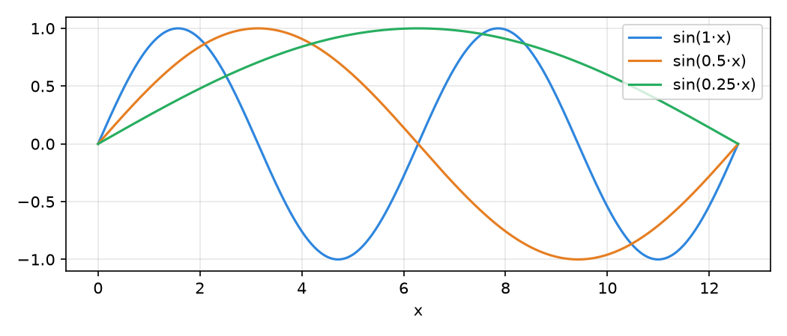

# md2pdf-latex: example document

This page is written in plain Markdown and typeset by LaTeX. Inline math like $e^{i\pi} + 1 = 0$ or
$\mathrm{softmax}(x)_i = e^{x_i} / \sum_j e^{x_j}$ uses real TeX, and so does display math:

$$
\mathrm{Attention}(Q, K, V) = \mathrm{softmax}\!\left(\frac{QK^\top}{\sqrt{d_k}}\right) V
$$

## Tables sized from their content

A narrow table keeps its natural width:

| Symbol | Meaning |
|---|---|
| $d$ | model width |
| $T$ | sequence length |

A wide table shares the line between its columns, so long names never overlap and text wraps only where needed:

| Experiment name | What changed | Learning rate | Batch | Steps | Result |
|---|---|---|---|---|---|
| `baseline_small_model_run` | nothing: the reference configuration everyone else is compared to | 0.001 | 32 | 5,000 | finished normally |
| `wider_ffn_variant_run` | feed-forward layer made twice as wide, everything else unchanged | 0.001 | 32 | 5,000 | finished normally |
| `huge_learning_rate_run` | learning rate raised far beyond the stable range | 0.3 | 32 | 694 | diverged |

## Code that wraps

```python
def a_function_with_a_rather_long_signature(first_argument, second_argument, third_argument, fourth_argument=None):
    return [first_argument, second_argument, third_argument, fourth_argument]  # long lines wrap instead of running off the page
```

## Colored blocks

<div style="color:#2e8b57">

**Answer:** an HTML `<div style="color:#RRGGBB">` around Markdown becomes a colored block in the PDF, which is handy
for telling answers apart from questions.

</div>

## Figures with labels

**Learning curve:** 

*A label and its figure are kept together on one page, and the figure is centered.*

## Unicode

Arrows and symbols → ≈ × ✓ ⚠, subscripts like ωₖ, accents (Ünïcödé), and other scripts (こんにちは) all render,
thanks to a chain of fallback fonts.
